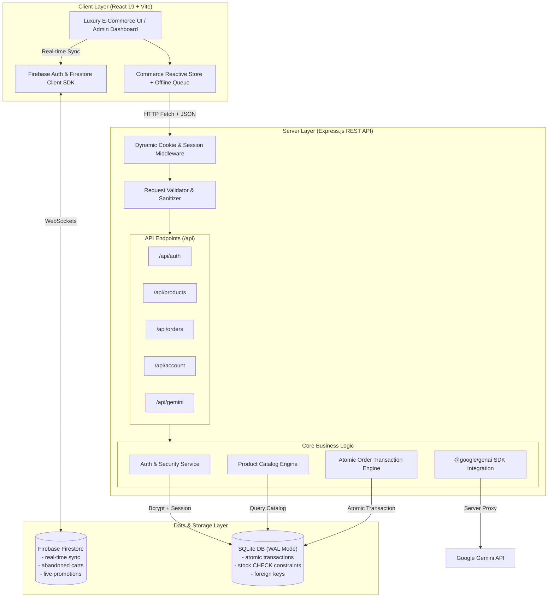

# 👑 فخامة | Fakhama Luxury Store

> **Production-Grade Luxury E-Commerce Platform & Real-Time Management System**  
> *Engineered with React 19, TypeScript, Express.js, SQLite, Firebase, Tailwind CSS v4, and Gemini 2.5 AI.*

---


---

## 🌟 Overview

**فخامة (Fakhama)** is a full-stack, enterprise-ready luxury e-commerce application designed for high-end horology, audio systems, smart wearables, and haute couture. Built with a **server-authoritative security model**, the platform guarantees transactional integrity, zero client-side price tampering, real-time stock verification, and seamless multi-channel data synchronization.

The system combines a **hybrid data architecture**:
1. **SQLite (WAL Mode)** as the primary transactional engine for ACID-compliant orders, session management, and inventory deductions.
2. **Firebase Firestore** as the real-time client state layer for live promotions, abandoned cart recovery, instant customer support tickets, and guest checkout order tracking.
3. **Gemini 2.5 Flash AI** server-side proxy powering an interactive AI Concierge for personalized product recommendations and client styling.

---

## 🏗️ Architecture Diagram



---

## ✨ Features Showcase

### 🛍️ Client Storefront
| Feature | Description |
|---|---|
| 👑 **Interactive Hero Grid (`MainVisualHero`)** | 18-tile dynamic product swapper with randomized, staggered crossfade transitions and fallback to vibrant luxury color cards for products without images. |
| 🎛️ **3D Live Mosaic Tile (`LiveTileHero`)** | 8x4 partition matrix with 3D Y/X rotation states, live content pool swapping, and editorial showcases. |
| 🔍 **Search & Autocomplete** | Instant multi-attribute search across names, categories, and descriptions with keyboard navigation and price previews. |
| 🍱 **Category Bento Grid** | Responsive visual showcase highlighting flagship collections (Audio, Wearables, Couture, Accessories). |
| ⚖️ **Product Comparison Drawer** | Side-by-side comparison matrix evaluating specs, materials, water resistance, and warranty details. |
| 🛒 **Cart & Inventory Validation** | Real-time stock warnings, quantity steppers, server-side subtotal recalculation, and promo coupon application. |
| 🧾 **Atomic Transactional Checkout** | Server-authoritative order processing with live inventory locking, unit price snapshots, and shipping address validation. |
| 📍 **Live Order Timeline Tracking** | Step-by-step visual tracker (Order Placed → Processing → Shipped → Delivered) backed by Firestore real-time updates. |
| 🤖 **AI Shopping Concierge** | Gemini 2.5 Flash assistant providing personal styling, gift recommendations, and product query answering. |

---

### 🛡️ Admin Control Panel (`/admin`)
| Module | Capability |
|---|---|
| 📊 **Sales Analytics** | Interactive revenue charts (Recharts), average order value (AOV), conversion rates, and sales breakdown by category. |
| 📦 **Product Catalog & Stock Control** | Full CRUD for products, inline inventory editing, SKU tracking, low-stock alerts, and image URL management. |
| 🛒 **Order Fulfillment Management** | Order status updater, customer shipping details inspect, itemized receipts, and refund/cancellation controls. |
| 👥 **Customer Relationship Management** | Customer profile directory, lifetime value (LTV) calculation, order history lookup, and VIP tier assignment. |
| 🏷️ **Marketing & Promotions** | Active coupon manager, discount code generator (`FAKHAMA2026`), banner promotions, and expiry tracking. |
| 📁 **Media Library & Assets** | Centralized image asset manager with tile croppers, asset grid view, and CDN link generators. |
| 🔌 **Integration Tracker** | Real-time status monitor for SQLite, Firebase Firestore, Gemini API, and Session Storage health. |

---

## 🔐 Security & Transactional Safeguards

1. **Server-Authoritative Pricing & Stock Verification**:
   - The client cart transmits **only** `{ productId, quantity }`.
   - Prices, subtotals, taxes, shipping fees, and inventory checks are executed **strictly server-side** inside an atomic SQLite transaction.
   - Database level `CHECK (stock >= 0)` constraints prevent overselling under concurrent requests.
2. **Password & Session Security**:
   - Passwords are encrypted using `bcryptjs` with 10 salt rounds.
   - Express sessions use `connect-sqlite3` storage transmitted via `httpOnly`, dynamic environment-adaptive cookies (`SameSite=None` on HTTPS, `SameSite=Lax` on HTTP).
3. **Data Isolation**:
   - Order lookups `/api/orders/:id` enforce strict ownership checks (`user_id = session.user_id`). Unauthorized requests return `404 Not Found`.
4. **Firebase Security Rules (`firestore.rules`)**:
   - Role-based authorization rules protecting user profiles, orders, and promotion documents against unauthenticated modifications.

---

## 📁 Repository Directory Structure

```text
/
├── database/                   # Database DDL & Data Initializers
│   ├── schema.sql              # Relational DDL (users, sessions, products, orders, order_items)
│   ├── seed.js                 # Curated luxury catalog seeder
│   ├── migrations.js           # Schema migration scripts
│   └── ecommerce.db            # SQLite persistent database file
│
├── server/                     # Express.js REST API Backend
│   ├── config/
│   │   └── database.js         # SQLite connection driver (WAL mode, foreign keys)
│   ├── middleware/
│   │   ├── auth.js             # Session validation & route protection guards
│   │   ├── errorHandler.js     # Standardized JSON error response handler
│   │   └── validation.js       # Payload schemas & parameter sanitizers
│   ├── routes/
│   │   ├── authRoutes.js       # Authentication endpoints (/api/auth)
│   │   ├── accountRoutes.js    # Customer profiles & addresses (/api/account)
│   │   ├── productRoutes.js    # Catalog & search endpoints (/api/products)
│   │   ├── orderRoutes.js      # Transactional orders endpoints (/api/orders)
│   │   └── geminiRoutes.js     # Gemini AI proxy endpoints (/api/gemini)
│   ├── services/
│   │   ├── authService.js      # Password hashing, registration, sessions
│   │   ├── productService.js   # Product querying, filtering, stock checks
│   │   ├── orderService.js     # Atomic SQLite order processing engine
│   │   └── geminiService.js   # @google/genai SDK integration
│   ├── server.js               # Express application entry point & Vite middleware
│   ├── test-foundation.js      # Test Suite 1: SQLite connection & schema
│   ├── test-phase2.js          # Test Suite 2: Auth & product services
│   ├── test-phase3.js          # Test Suite 3: Transactional order processing
│   ├── test-api-http.js        # Test Suite 4: End-to-end HTTP API tests
│   ├── test-frontend-cart.js   # Test Suite 5: Client cart logic & calculation
│   ├── test-deep-security.js   # Test Suite 6: Isolation & SQL injection security
│   ├── test-auth-regression.js # Test Suite 7: Session cookie security regression
│   └── test-e2e-checkout.js    # Test Suite 8: Full e2e checkout flow
│
├── src/                        # React 19 Frontend Application
│   ├── main.tsx                # Entry point
│   ├── App.tsx                 # Root router & layout configuration
│   ├── admin/                  # Multi-module Admin Dashboard
│   │   ├── pages/              # Admin views (Analytics, Inventory, Orders, Customers, etc.)
│   │   ├── components/         # Admin UI widgets, sidebar, stats cards
│   │   └── context/            # Admin auth & navigation state
│   ├── api/                    # API client layer (Fetch wrapper with error handling)
│   ├── components/             # Reusable UI Components
│   │   ├── ai/                 # AI Concierge drawer & chat interface
│   │   ├── home/               # Hero sections (MainVisualHero, LiveTileHero, HeroSpotlight)
│   │   ├── product/            # Product cards, quick view modal, reviews
│   │   ├── cart/               # Cart slide-over & item rows
│   │   ├── compare/            # Product comparison drawer
│   │   └── layout/             # Header, Footer, Mobile Navigation
│   ├── context/                # React Contexts (AuthContext, CartContext, WishlistContext)
│   ├── hooks/                  # Custom React Hooks (useProducts, useOrders, useAuth)
│   ├── pages/                  # Page Views (HomePage, ProductsPage, CheckoutPage, etc.)
│   ├── shared/                 # Shared store, event bus, and Firestore sync engine
│   └── types/                  # Global TypeScript Interfaces & Enums
│
├── firebase-applet-config.json # Firebase project configuration
├── firestore.rules             # Firestore security rules
├── metadata.json               # Platform metadata & capabilities
├── package.json                # Dependencies, scripts, and project metadata
├── tsconfig.json               # TypeScript configuration
└── vite.config.ts              # Vite configuration & Tailwind CSS plugin
```

---

## 📡 RESTful API Documentation

### 🔑 Authentication (`/api/auth`)
- `POST /api/auth/register` — Register a new account (`name`, `email`, `password`).
- `POST /api/auth/login` — Sign in with email & password. Establishes `httpOnly` session cookie.
- `POST /api/auth/logout` — Revokes active session in database and clears session cookie.
- `GET /api/auth/me` — Returns authenticated user profile (`id`, `name`, `email`).

### 📦 Products Catalog (`/api/products`)
- `GET /api/products` — Query catalog with filters (`category`, `search`, `minPrice`, `maxPrice`, `sort`).
- `GET /api/products/categories` — List distinct product categories.
- `GET /api/products/:id` — Retrieve detailed information for a single product with live stock count.

### 🛒 Orders & Checkout (`/api/orders`) — *Requires Authentication*
- `POST /api/orders` — Atomically processes checkout inside an SQLite transaction. Calculates subtotals, verifies live stock, decrements inventory, and saves itemized order details.
- `GET /api/orders` — Retrieve past order history for the authenticated user.
- `GET /api/orders/:id` — Retrieve itemized receipt for an order (strictly owner-isolated).

### 🤖 Gemini AI Proxy (`/api/gemini`)
- `POST /api/gemini/chat` — Send query to Gemini 2.5 Flash AI Concierge and receive context-aware styling/product advice.
- `POST /api/gemini/recommendations` — Fetch AI-curated product recommendations based on user preferences.

---

## 🛠️ Tech Stack & Dependencies

| Layer | Technology |
|---|---|
| **Frontend Framework** | React 19.0, TypeScript 5.8, Vite 6.2 |
| **Routing & State** | React Router DOM v7, TanStack React Query v5 |
| **Styling & Motion** | Tailwind CSS v4, Motion v12, Lucide React Icons |
| **Data Visualization** | Recharts v3 |
| **Backend Runtime** | Node.js v22+, Express.js v4.21 |
| **Relational Database** | SQLite (via `better-sqlite3` & `connect-sqlite3`) |
| **Real-time Database** | Firebase Firestore v12.18 & Firebase Auth |
| **Artificial Intelligence** | Google Gen AI SDK (`@google/genai` v2.4) with Gemini 2.5 Flash |

---

## ⚙️ Environment Configuration

Create a `.env` file in the root directory based on `.env.example`:

```env
# Server Port Configuration
PORT=3000

# Environment Mode
NODE_ENV=development

# Session Encryption Secret
SESSION_SECRET=fakhama_super_secure_session_secret_key_2026

# Google Gemini AI API Key (Server-side secret)
GEMINI_API_KEY=your_gemini_api_key_here
```

---

## 🚀 Getting Started

### Prerequisites
- **Node.js**: v20.0.0 or higher
- **npm**: v10.0.0 or higher

### 1. Installation
Clone the repository and install dependencies:

```bash
git clone https://github.com/your-username/fakhama-luxury-store.git
cd fakhama-luxury-store
npm install
```

### 2. Seed Database
Initialize the SQLite database schema and populate initial catalog items:

```bash
npm run seed
```

### 3. Start Development Server
Run the Express backend with Vite HMR middleware:

```bash
npm run dev
```
Access the application at `http://localhost:3000`.

---

## 🧪 Testing Suite

The repository features **8 comprehensive automated test suites** covering database transactions, API endpoints, cart math, and deep security isolation:

```bash
npm test
```

### Individual Test Suites:
```bash
# 1. Foundation Tests (SQLite connection, WAL mode, Schema)
npm run test:foundation

# 2. Phase 2 Tests (Auth service, Password hashing, Product querying)
npm run test:phase2

# 3. Phase 3 Tests (Atomic order creation, Stock deduction, Price locking)
npm run test:phase3

# 4. HTTP API Tests (Express routes, Middleware validation, Status codes)
npm run test:api

# 5. Frontend Cart Logic Tests (Subtotals, Discounts, Quantity bounds)
npm run test:frontend

# 6. Deep Security Tests (SQL injection prevention, Owner route isolation)
npm run test:security

# 7. Auth Regression Tests (Dynamic HTTP/HTTPS cookie security)
npm run test:auth-regression

# 8. E2E Checkout Flow Tests (Full customer checkout to receipt creation)
npm run test:e2e
```

---

## 📄 License

This project is licensed under the **MIT License** — see the `LICENSE` file for details.

---

<p align="center">
  <b>Designed & Engineered for Fakhama Luxury Store • 2026 Edition</b>
</p>
